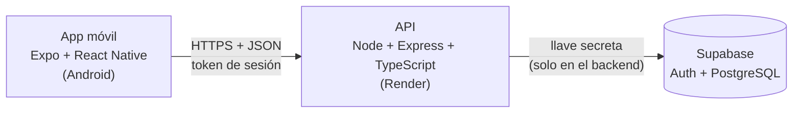

# DevLevel

Juego móvil para aprender lógica de programación. El jugador recorre un reino de 15 mazmorras y en cada una escribe un pequeño programa en **pseudocódigo en español** para mover a su héroe: esquivar pinchos, recoger monedas, pelear con goblins y llegar a la puerta. Al principio el programa se arma con bloques que se tocan, y a medida que avanza el jugador pasa a escribir el código él mismo.

Proyecto final de **Desarrollo de Aplicaciones Móviles**, Universidad de La Sabana (2026-2).

| Integrante | Rol principal |
|---|---|
| Ethian White | Backend, base de datos, motor de mazmorras, despliegue y pantallas de juego |
| Tatiana Mayorga | Pantallas de la app, configuración y accesibilidad |

- **API pública:** https://devlevel-api.onrender.com (salud: `/health`)
- **APK de Android:** se genera con EAS (ver [Generar el APK](#generar-el-apk)).
- **Documento técnico final:** [`docs/DevLevel_Documento_Final.pdf`](docs/DevLevel_Documento_Final.pdf) (versión Markdown en [`docs/DevLevel_Documento_Final.md`](docs/DevLevel_Documento_Final.md)).

---

## Cómo se juega

1. **Concepto:** cada nivel empieza con una explicación corta del tema (pasos, variables, decisiones, ciclos o funciones).
2. **Mazmorra:** una cuadrícula pixel art con el héroe, muros, pinchos, monedas, enemigos y una puerta. El jugador arma su hechizo (programa), toca **▶ Ejecutar** y ve al héroe moverse paso a paso.
3. **Subida de nivel:** se ganan estrellas, XP, racha, el hechizo del nivel en el Libro de hechizos y, si se cumplen todos los objetivos ★, una **reliquia**.

Ejemplo de hechizo:

```
MIENTRAS NO en_salida HACER
  SI hay_enemigo ENTONCES
    atacar()
  SINO
    adelante()
  FIN
FIN
```

| Unidad | Tema | Cómo se arma el código |
|---|---|---|
| 1 | Pensar en pasos | Bloques |
| 2 | Guardar información | Bloques, con variables |
| 3 | Tomar decisiones | Bloques con `SI` o texto ("Escribirlo yo") |
| 4 | Repetir sin cansarse | Editor de texto con barra de atajos |
| 5 | Bloques reutilizables | Editor de texto con `FUNCION` |

- **Objetivos extra (★):** terminar con todas las monedas, sin chocar, sin recibir daño, con pocas instrucciones o derrotando a todos los enemigos. Estrellas = 1 por ganar + 1 por cada objetivo extra cumplido.
- **Reliquias:** 15 objetos normales (armas, armaduras y amuletos) y 10 **míticos** en rojo (Rayo de Zeus, Martillo de Thor, Llave Maestra…). Cada vez que se gana un objeto hay un 10 % de que salga un mítico, y la probabilidad baja a medida que se tienen más (10 % × 0,8 por cada mítico ya ganado). Se equipan en **Héroe → Equipo** y cambian el combate o habilitan instrucciones nuevas.
- El detalle completo del juego está en [`docs/diseno-juego-mazmorras.md`](docs/diseno-juego-mazmorras.md).

---

## Arquitectura



- **La app nunca habla con Supabase directamente.** Todas las tablas tienen RLS activado y sin políticas, así que solo el backend (con la llave secreta) puede leer y escribir.
- **El backend es la autoridad del juego.** La app simula la mazmorra para mostrar la animación, pero el backend vuelve a ejecutar el programa con el equipo que el jugador realmente tiene, y con ese resultado da las estrellas, la XP y los objetos. Por eso no se puede hacer trampa enviando un resultado falso.
- **Motor compartido.** El lector del pseudocódigo, el simulador y los objetos están escritos en TypeScript puro en `backend/src/lib/mazmorra/`. La app tiene una copia idéntica en `movil/src/juego/` (`npm run motor:copiar` la actualiza y una prueba automática revisa que sean iguales).
- **Sesión:** el token se guarda cifrado en el celular con `expo-secure-store` y se renueva solo con `/auth/refresh`.

### Estructura del repositorio

```
DevLevel/
├── backend/                 API (Node + Express + TypeScript)
│   ├── src/
│   │   ├── routes/          Endpoints: auth, me, mapa, niveles, retos, completar, inventario, hechizos
│   │   ├── lib/mazmorra/    Motor del juego: lector, simulador, objetos y las 15 mazmorras
│   │   └── middleware/      Validación del token
│   ├── supabase/            Esquema SQL y datos iniciales
│   ├── scripts/             Generador del seed de mazmorras y copia del motor a la app
│   └── test/                Pruebas automáticas (Supabase falso en memoria)
├── movil/                   App (Expo SDK 58 + expo-router)
│   └── src/
│       ├── app/             Pantallas (rutas por archivos)
│       │   ├── (tabs)/      Mapa, Hechizos, Héroe y Ajustes
│       │   ├── nivel/[id]   Concepto → mazmorra → subida de nivel
│       │   └── login, onboarding, personaje, recuperar
│       ├── components/      Mazmorra, editor de bloques y de texto, mapa del reino, pixel art, UI retro
│       ├── juego/           Copia del motor + lógica de los bloques
│       ├── context/         Sesión, preferencias y onboarding
│       ├── api/             Cliente HTTP y tipos de la API
│       └── theme/           Colores, tipografías, tamaños y área táctil mínima
├── docs/                    Diseño del juego y documento final
└── PLAN_DE_TRABAJO.md       Plan diario con quién hizo cada tarea y en qué commit
```

---

## Requisitos

- **Node.js 22 o superior** (`@supabase/supabase-js` no funciona con Node 20).
- Un proyecto de **Supabase**.
- Para la app: el celular con **Expo Go**, o un emulador de Android. Para el APK: una cuenta de **Expo (EAS)**.

## Variables de entorno

Los archivos `.env` **nunca** se suben al repositorio. Cada carpeta tiene un `.env.example` para copiar.

**`backend/.env`**

| Variable | Qué es |
|---|---|
| `PORT` | Puerto local del servidor (por defecto 3000; Render pone el suyo) |
| `SUPABASE_URL` | Supabase → Project Settings → Data API → Project URL |
| `SUPABASE_SECRET_KEY` | Supabase → Project Settings → API Keys → Secret key. Se salta RLS: solo vive en el backend |

**`movil/.env`**

| Variable | Qué es |
|---|---|
| `EXPO_PUBLIC_API_URL` | URL del backend. Desde un celular no sirve `localhost`: usar la IP del computador en la red (por ejemplo `http://192.168.1.20:3000`) o la URL de Render |

En el APK, `EXPO_PUBLIC_API_URL` se toma del perfil de `movil/eas.json` y apunta a Render.

---

## Instalación y ejecución

### 1. Base de datos (Supabase)

En **SQL Editor → New query**, ejecutar en este orden (cada archivo en su propia consulta):

1. `backend/supabase/schema.sql`: tablas con RLS activado.
2. `backend/supabase/seed.sql`: 5 unidades y 15 niveles.
3. `backend/supabase/migracion-mazmorras.sql`: tipo de reto `mazmorra`, tabla `inventario` y equipo del perfil.
4. `backend/supabase/seed-mazmorras.sql`: las 15 mazmorras (se genera con `npm run seed:mazmorras`).

Todos se pueden ejecutar más de una vez sin duplicar datos.

Para el correo de "¿Olvidaste tu contraseña?", en **Authentication → Emails** la plantilla *Reset Password* debe mostrar el código con `{{ .Token }}`.

### 2. Backend

```bash
cd backend
npm install
cp .env.example .env   # llenar SUPABASE_URL y SUPABASE_SECRET_KEY
npm run dev
```

Queda en `http://localhost:3000`. Para comprobarlo: `http://localhost:3000/health`. Los endpoints, con ejemplos de petición y respuesta, están en [`backend/README.md`](backend/README.md).

### 3. App

```bash
cd movil
npm install
cp .env.example .env   # poner la URL del backend
npx expo start
```

Escanear el código QR con Expo Go, o presionar `a` para abrirla en el emulador de Android.

### Generar el APK

```bash
cd movil
npx eas-cli build -p android --profile preview
```

Al terminar, EAS entrega el enlace de descarga del `.apk`. Se instala en Android permitiendo "instalar apps de origen desconocido".

> En el plan gratis de Render el backend se duerme tras 15 minutos sin uso y la primera petición tarda unos 50 segundos. Antes de una demo hay que abrir `https://devlevel-api.onrender.com/health` para despertarlo.

---

## Pruebas y calidad

| Comando | Dónde | Qué revisa |
|---|---|---|
| `npm test` | `backend/` | 159 pruebas automáticas: auth, recuperación de contraseña, retos, completar nivel, mazmorras, inventario, motor (lector, simulador, combate, objetos y míticos), que las 15 mazmorras se puedan ganar y que la copia del motor en la app sea idéntica |
| `npm run typecheck` | `backend/` | Tipos de TypeScript |
| `npx tsc --noEmit` | `movil/` | Tipos de TypeScript |
| `npm run lint` | `movil/` | ESLint con `eslint-plugin-react-native-a11y` (reglas de accesibilidad) |

Las pruebas del backend levantan la API real, pero usan una base de datos falsa en memoria: no necesitan `.env`, no tocan los datos reales y funcionan sin internet.

Los casos de prueba funcionales ejecutados contra el sistema desplegado (flujos principales y errores de red y validación), con sus resultados y capturas, están en [`docs/casos-de-prueba.md`](docs/casos-de-prueba.md).

---

## Accesibilidad

- **Lector de pantalla (TalkBack):** todos los botones, pestañas, casillas y campos tienen `accessibilityRole`, `accessibilityLabel` y `accessibilityState` (seleccionado, deshabilitado, expandido). La mazmorra se describe con texto (dónde está el héroe, a dónde mira, qué hay enfrente) y el resultado de cada ejecución se anuncia con regiones vivas.
- **Áreas táctiles de al menos 48 dp** en todos los controles.
- **Nada se arrastra:** los bloques se agregan, se mueven (↑ ↓) y se borran (🗑) con toques.
- **Ícono + texto:** ningún estado se comunica solo con color (por ejemplo, los míticos dicen "MÍTICO" además de ir en rojo, y los errores llevan ⚠ y texto).
- **Contraste mínimo de 4.5:1** en los textos sobre el fondo oscuro.
- **Errores debajo de cada campo** en login, registro y recuperación, anunciados como alerta.
- **Ajustes:** reducir movimiento (sigue también la opción del sistema y cambia las animaciones por versiones estáticas), sonido y vibración.
- **Teclado:** los formularios y el editor de código se desplazan para que el teclado no tape el campo activo.
- El texto respeta el tamaño de letra del sistema.

---

## Tecnologías

**App:** Expo, React Native, TypeScript, expo-router, expo-secure-store, react-native-svg (sprites pixel art), react-native-keyboard-controller y EAS Build.
**Backend:** Node.js, Express 5, TypeScript, Supabase (Auth y PostgreSQL) y despliegue en Render.
