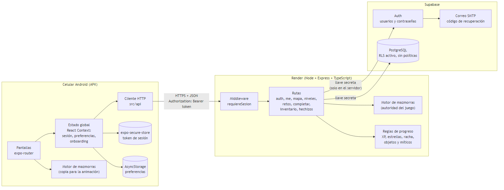
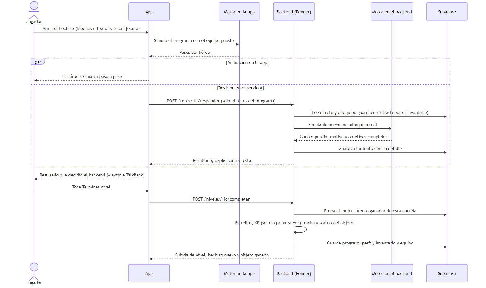

# DevLevel — Documento Técnico Final (Fase 3)

**Aprende a pensar como programador, un nivel a la vez**
Desarrollo de Aplicaciones Móviles · Universidad de La Sabana · Ethian White y Tatiana Mayorga · 12 de noviembre de 2026
Repositorio: https://github.com/EthianWhor/DevLevel · API: https://devlevel-api.onrender.com

Los detalles completos de cada sección están en `docs/` (secciones 1 a 5, matriz de trazabilidad, casos de prueba, auditoría en dispositivo y diagramas).

---

## 1. Visión del producto, problema y estado del arte

### 1.1 Resumen ejecutivo y propuesta de valor

DevLevel es un juego para Android que enseña lógica de programación desde cero y en español. El jugador recorre un reino de 5 regiones y 15 mazmorras; en cada una escribe un programa en pseudocódigo para que su héroe llegue a la salida: avanzar, girar, saltar pinchos, recoger monedas y pelear con enemigos. Al principio el programa se arma tocando bloques, y en las últimas regiones se escribe a mano, con variables, condiciones, ciclos y funciones.

**Propuesta de valor:** la aplicación que enseña a *pensar* como programador, no a ser programador.

| Persona | Perfil | Dolor |
|---|---|---|
| Primaria | Estudiante de 13 a 25 años sin experiencia | Se abrumó con tutoriales y cursos desordenados |
| Secundaria | Profesional de 22 a 30 años | No tiene tiempo para un curso largo y formal |
| Con necesidades de accesibilidad | Estudiante de 19 años con baja visión que usa TalkBack y letra grande | Las apps de programación dependen de arrastrar bloques, de colores sin texto y de animaciones que no se pueden detener |

### 1.2 Problema y evolución desde la Fase 1

Aprender a programar por cuenta propia abruma por exceso de información desordenada; los cursos en línea masivos tienen tasas de finalización de apenas el 5 % al 15 % [1]. La primera versión de DevLevel resolvía cada nivel con preguntas tipo cuestionario. La rediseñamos para que **cada nivel se supere programando**: el héroe ejecuta el programa paso a paso y el jugador ve exactamente dónde falla. Se agregaron objetivos extra (★) y 25 reliquias (15 normales y 10 míticas) que cambian el combate.

La Fase 1 planteaba retroalimentación con IA como funcionalidad deseable. La versión entregada usa retroalimentación **determinista**: el error con número de línea y sugerencia ("¿Quisiste decir 'adelante()'?"), el motivo de la derrota y una pista por mazmorra. No depende de servicios externos y siempre es correcta; la IA queda como trabajo futuro.

### 1.3 Análisis competitivo actualizado

| | SoloLearn | Mimo | Codecademy | CodeCombat | **DevLevel** |
|---|---|---|---|---|---|
| Formato | Lecciones tipo cuestionario | Rutas de lecciones cortas | Cursos en el navegador | RPG con código real | **Mazmorras donde el héroe ejecuta el programa del jugador** |
| Enseña | Sintaxis | Desarrollo web y Python | Lenguajes y carreras | Python y JavaScript | **Lógica: secuencia, variables, condiciones, ciclos y funciones** |
| Idioma | Inglés | Inglés | Inglés | Inglés | **Español nativo, incluido el lenguaje del juego** |
| Plataforma | Móvil y web | Móvil y web | Web | Web | **Android** |
| Modelo | Práctica de pago | Casi todo de pago | Plus y Pro de pago | Suscripción | **Todo el contenido disponible** |

### 1.4 Innovación frente al estado del arte

- **Pensamiento computacional antes que sintaxis** [2]: 6 acciones, 5 condiciones, `SI`, `REPETIR`, `MIENTRAS`, variables y `FUNCION`.
- **Transición gradual de bloques a texto** [3]: unidades 1 y 2 con bloques, unidad 3 mixta y unidades 4 y 5 con editor de texto. Los bloques generan exactamente el mismo texto que se escribe a mano.
- **Gamificación con retroalimentación inmediata** [4]: XP, niveles, rachas, estrellas, objetivos opcionales y reliquias.
- **Accesible desde el diseño:** el escenario se describe en texto para el lector de pantalla y todo se juega con toques.

---

## 2. Arquitectura e implementación técnica

### 2.1 Arquitectura de punta a punta

*Figura 1. App Expo (Android) → API propia en Render → Supabase.*

| Capa | Tecnología | Responsabilidad |
|---|---|---|
| App | Expo SDK 58, React Native 0.88, TypeScript, expo-router, React Context | Pantallas, editor de bloques y de texto, animación, accesibilidad |
| API | Node 22, Express 5, TypeScript (Render) | Autenticación, validación, ejecución autoritativa de programas, progreso y objetos |
| Datos | Supabase Auth y PostgreSQL | Usuarios, contenido, progreso, intentos e inventario |

### 2.2 Decisiones arquitectónicas

| Decisión | Por qué |
|---|---|
| La app solo habla con una API propia; RLS activo **sin políticas** | La llave secreta y las reglas viven en el servidor; nadie puede leer la base de datos desde el APK |
| **El backend es la autoridad del juego** y vuelve a ejecutar cada programa | Estrellas, XP y objetos no se pueden falsificar; la app solo envía el texto del programa |
| **Motor de mazmorras compartido** en TypeScript puro (`backend/src/lib/mazmorra` y copia en `movil/src/juego`) | La app anima al instante y el servidor llega al mismo resultado; una prueba verifica que las copias sean idénticas |
| Pseudocódigo con lector propio, sin `eval` | Seguro, en español, con errores por línea y límite de 500 pasos contra ciclos infinitos |
| React Context para el estado global (sesión, preferencias, onboarding) | El estado global es pequeño; el de cada pantalla vive en ella |
| Token en `expo-secure-store` (Keystore de Android); preferencias en AsyncStorage | Lo sensible queda cifrado |

**Navegación:** expo-router con `Stack.Protected`: el onboarding, el login y las pantallas con sesión solo existen cuando su condición es verdadera, así que tras cerrar sesión no se puede volver atrás. **Estado asíncrono:** `conSesion()` llama a la API con el token y, si recibe 401, renueva la sesión una sola vez aunque haya varias peticiones a la vez. Los errores de red se convierten en mensajes claros ("No hay conexión con el servidor") y nunca cierran la sesión.

**Rendimiento en vistas complejas:** los sprites pixel art se dibujan como un solo SVG con los píxeles del mismo color agrupados por fila y memorizados (`memo` y `useMemo`). El terreno de la mazmorra se dibuja una sola vez y solo se repintan el héroe y los enemigos. Las animaciones usan `useNativeDriver`. La app anima al héroe mientras el servidor responde, así la espera de red no se nota.

### 2.3 Modelo de datos y contratos de servicio

| Tabla | Contenido |
|---|---|
| `profiles` | Héroe, clase, XP, nivel, racha y equipo (JSON: arma, armadura, amuleto) |
| `unidades`, `niveles`, `retos` | 5 unidades, 15 niveles y una mazmorra por nivel (mapa, energía, instrucciones y objetivos) |
| `progreso_niveles` | Mejores estrellas por usuario y nivel |
| `intentos_retos` | Cada programa enviado, si ganó y su detalle |
| `inventario` | Reliquias ganadas y si son míticas |

Endpoints principales (JSON; errores `{ error, campos }`): `POST /auth/register`, `/login`, `/refresh`, `/recuperar`, `/restablecer`; `GET/PATCH /me`; `GET /mapa`; `GET /niveles/:id` (sin la solución); `POST /retos/:id/responder` (ejecuta el programa en el servidor); `POST /niveles/:id/completar` (estrellas, XP, racha y sorteo de reliquia); `GET /inventario`; `GET /hechizos`.

*Figura 2. La app anima su propia simulación mientras el backend ejecuta el programa y decide el resultado.*

---

## 3. Implementación y auditoría de accesibilidad móvil

La accesibilidad se abordó como una decisión de arquitectura desde los componentes base, tomando WCAG 2.1 y 2.2 nivel AA como marco y adaptándolo a las propiedades nativas de React Native.

- **Semántica para TalkBack:** los componentes interactivos usan `accessibilityRole`, `accessibilityLabel`, `accessibilityHint`, `accessibilityState` y `accessibilityValue`. El escenario de la mazmorra se describe en texto (dónde está el héroe, hacia dónde mira y qué tiene enfrente) y el resultado de cada ejecución se anuncia con `announceForAccessibility`.
- **Contraste y tipografía:** contraste mínimo de 4,5:1 en el tema, `lineHeight` explícito en todos los textos y escalado de fuente del sistema sin bloquear. Ningún estado depende solo del color: los resultados llevan ✔/✖ y texto, los errores llevan ⚠ y texto, y los míticos dicen "MÍTICO" además de ir en rojo.
- **Ergonomía táctil:** áreas táctiles de al menos 48 dp (`AreaTactilMinima`) y `hitSlop` en controles pequeños. El editor de bloques funciona solo con toques, sin arrastrar (WCAG 2.5.1 y 2.5.7). Hay retroalimentación visual, anuncios y vibración opcional.
- **Control del usuario:** las preferencias Reducir movimiento, sonido y vibración se guardan en AsyncStorage. `useReducirMovimiento` combina la preferencia con el ajuste del sistema (`AccessibilityInfo.isReduceMotionEnabled`) y las pantallas animadas muestran una versión estática.

### 3.1 Matriz de trazabilidad (propuesta del Segundo Corte vs. implementación final)

| ID | Mejora prometida | WCAG | Dónde (`movil/src/`) | Validación | Estado |
|---|---|---|---|---|---|
| A-01 | Roles en botones, tarjetas, encabezados, pestañas y switches | 4.1.2, 1.3.1 | `components/ui/*`, `components/app-tabs.tsx` | Código, lint y TalkBack | ✅ |
| A-02 | Etiquetas y pistas en las acciones | 4.1.2, 2.5.3 | `components/ui/*`, `components/mazmorra/*` | Código y TalkBack | ✅ |
| A-03 | Estados anunciados (deshabilitado, activado, seleccionado, expandido) | 4.1.2 | `boton-principal.tsx`, `fila-switch.tsx`, `editor-bloques.tsx`, `panel-equipo.tsx` | TalkBack | ✅ |
| A-04 | Área táctil mínima de 48 dp | 2.5.8 | `theme/espaciado.ts` y componentes | Código y dispositivo (D-17) | ✅ |
| A-05 | Nada exige arrastrar | 2.5.1, 2.5.7 | `components/mazmorra/editor-bloques.tsx` | TalkBack (D-08 y D-09) | ✅ |
| A-06 | Resultado con ícono, texto y vibración, no solo color | 1.4.1 | `components/mazmorra/pantalla-mazmorra.tsx` | Código y dispositivo | ✅ |
| A-07 | Anuncio automático del resultado | 4.1.3 | `pantalla-mazmorra.tsx`, `subida-nivel.tsx` | TalkBack (D-10) | ✅ |
| A-08 | Progreso anunciado como "N de M" | 4.1.2 | `barra-progreso.tsx`, `subida-nivel.tsx` | Código | ✅ |
| A-09 | Escalado de fuente y `lineHeight` explícito | 1.4.4 | `theme/tipografia.ts` | Código y dispositivo (D-15) | ⚠️ Se lee, con 2 superposiciones menores |
| A-10 | Niveles bloqueados con candado y texto; contraste 4,5:1 | 1.4.1, 1.4.3 | `components/mapa/*`, `constants/retro.ts` | Código y cálculo de contraste | ✅ |
| A-11 | Imágenes con descripción | 1.1.1 | `app/onboarding.tsx` | Código | ✅ |
| A-12 | Errores de formulario bajo cada campo, con ícono y texto | 3.3.1, 1.4.1 | `app/login.tsx`, `components/ui/campo-texto.tsx` | Dispositivo (D-02) | ⚠️ Se ve, pero no se anuncia solo |
| A-13 | Reducir movimiento (app y sistema) con versiones estáticas | 2.3.3 | `hooks/use-reducir-movimiento.ts`, `subida-nivel.tsx`, `pantalla-mazmorra.tsx` | Código y dispositivo (D-16) | ✅ |
| A-14 | Análisis estático de accesibilidad sin advertencias | Transversal | `movil/eslint.config.js` (`eslint-plugin-react-native-a11y`) | `npm run lint` | ✅ |
| A-15 | Botón de peligro (cerrar sesión) accesible | 4.1.2 | `boton-principal.tsx`, `app/(tabs)/configuracion.tsx` | Código y TalkBack | ✅ |
| A-16 | Preferencias persistidas con efecto real | 2.3.3, 1.4.2 | `context/preferencias-context.tsx` | Código y dispositivo | ✅ |

La matriz completa, con criterios, métodos y evidencias por fila, está en `docs/matriz-trazabilidad-accesibilidad.md`.

---

## 4. Pruebas funcionales, rendimiento y validación

### 4.1 Casos de prueba ejecutados

Se ejecutaron **33 casos funcionales** contra el sistema desplegado (Render y Supabase reales): **33 de 33 pasan**. Además, el backend tiene **159 pruebas automáticas** (159 de 159 pasan), y la app pasa la revisión de tipos y el lint de accesibilidad.

| Grupo | Casos | Ejemplos |
|---|---|---|
| Autenticación | 10 | Datos inválidos con error por campo, correo repetido, contraseña incorrecta, token falso, renovación y recuperación sin revelar si el correo existe |
| Perfil y mapa | 5 | Nombre y clase inválidos, solo el nivel 1 disponible, nivel bloqueado (403), la solución nunca llega a la app |
| Mazmorra | 6 | Instrucción mal escrita con sugerencia, falta `FIN`, ciclo infinito cortado a los 500 pasos, sin energía |
| Progreso | 8 | 3 estrellas con reliquia equipada sola, repetir da 0 XP, equipar un objeto que no se tiene (400) |
| Interfaz | 4 | Errores bajo cada campo, mensaje sin conexión, mazmorra resuelta con bloques, subida de nivel con objeto |

Detalle y capturas: `docs/casos-de-prueba.md`.

### 4.2 Auditoría de accesibilidad en dispositivo

Se recorrió el APK final en un celular Android con TalkBack, con la letra del sistema al máximo y con "Quitar animaciones" (`docs/auditoria-dispositivo.md`): **15 pruebas cumplen, 1 cumple con observaciones, 1 no cumple y 1 queda sin probar** (onboarding). Con "Quitar animaciones" el héroe salta directo al resultado, y los botones pequeños responden al primer toque. TalkBack lee cada elemento con su nombre y tipo, describe el escenario, anuncia el resultado de cada ejecución y toda la mazmorra se juega con toques. **Hallazgo D-02:** el error del login se ve bajo el campo, pero TalkBack no lo anuncia solo, porque Android no lee una región viva que aparece por primera vez. La corrección (anunciar el error con `announceForAccessibility`) queda para la siguiente versión. **Hallazgo D-15:** con la letra al máximo todo se lee, pero en el mapa una etiqueta de nivel se monta sobre el letrero de la región y la pestaña "HECHIZOS" se parte en dos líneas.

### 4.3 Rendimiento

| Medida | Resultado |
|---|---|
| Respuesta de la API (mediana, servicio despierto) | 207 ms (`/health`) a 508 ms (`/retos/:id/responder`) |
| Arranque en frío de Render | 13,9 s medido; hasta unos 50 s según Render (la app espera hasta 60 s) |
| Motor: programa más largo / ciclo infinito | 0,2 ms / 0,1 ms |
| Tamaño del APK | 108 MB |

---

## 5. Conclusiones, limitaciones y trabajo futuro

**Lecciones aprendidas.** La accesibilidad funciona mejor como decisión de arquitectura que como capa final: al ponerla en los componentes base, cada pantalla nueva la heredó. Separar al cliente de la base de datos con una API propia nos permitió que el servidor fuera la autoridad del juego. Trabajar con Git en paralelo exigió comunicación constante, commits pequeños e integrar con rebase.

**Alcance logrado.** El producto cumple la visión de la Fase 1: un camino único por niveles, en español, para aprender lógica jugando. Se entregó un APK funcional de punta a punta con autenticación y recuperación de contraseña, 15 mazmorras jugables con editor de bloques y de texto, combate, 25 reliquias, progreso con XP y rachas, y preferencias de accesibilidad. Las 16 mejoras de accesibilidad del Segundo Corte quedaron implementadas, con observaciones en A-09 y A-12.

**Retos superados.** Convertir los niveles de cuestionario en mazmorras jugables sin perder el contenido pedagógico. Diseñar un lenguaje y un motor deterministas compartidos entre la app y el servidor. Hacer un editor de bloques accesible sin arrastrar. Desplegar el backend en Render con Supabase y RLS.

**Limitaciones.** Los errores del login no se anuncian solos con TalkBack (D-02). Con la letra al máximo, una etiqueta del mapa se superpone y una pestaña se parte en dos líneas (D-15). Los contrastes se calcularon sobre el tema y no sobre la app instalada. No hubo pruebas con usuarios con discapacidad. Solo hay versión de Android, y Render gratis tarda en despertar.

**Trabajo futuro.** Corregir D-02 y D-15, y completar la auditoría con el onboarding y Accessibility Scanner. Agregar retroalimentación con IA que explique los errores en lenguaje natural. Dar soporte a iOS y VoiceOver, y agregar audio real a la preferencia de sonido. Hacer pruebas con usuarios y crear nuevos módulos de contenido.

---

## Referencias

[1] K. Jordan, "Massive open online course completion rates revisited: Assessment, length and attrition," *Int. Rev. Res. Open Distrib. Learn.*, vol. 16, no. 3, pp. 341–358, 2015, doi: 10.19173/irrodl.v16i3.2112.

[2] J. M. Wing, "Computational thinking," *Commun. ACM*, vol. 49, no. 3, pp. 33–35, 2006, doi: 10.1145/1118178.1118215.

[3] D. Weintrop and U. Wilensky, "Comparing block-based and text-based programming in high school computer science classrooms," *ACM Trans. Comput. Educ.*, vol. 18, no. 1, Art. 3, 2017, doi: 10.1145/3089799.

[4] J. P. España-Marca, "Gamificación inteligente: Integración de IA adaptativa en ambientes virtuales de aprendizaje para educación básica," *MQRInvestigar*, vol. 9, no. 4, e1207, 2025, doi: 10.56048/MQR20225.9.4.2025.e1207.

[5] W3C, "Web Content Accessibility Guidelines (WCAG) 2.2," 2023. [Online]. Available: https://www.w3.org/TR/WCAG22/
