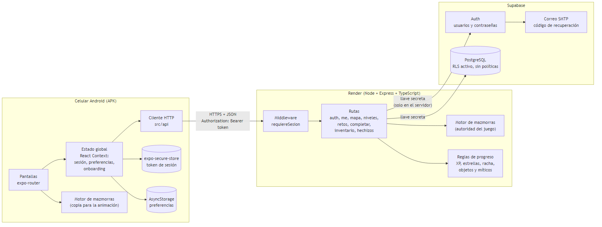
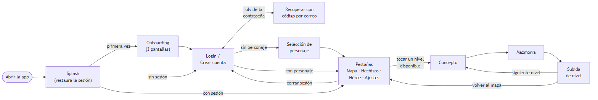
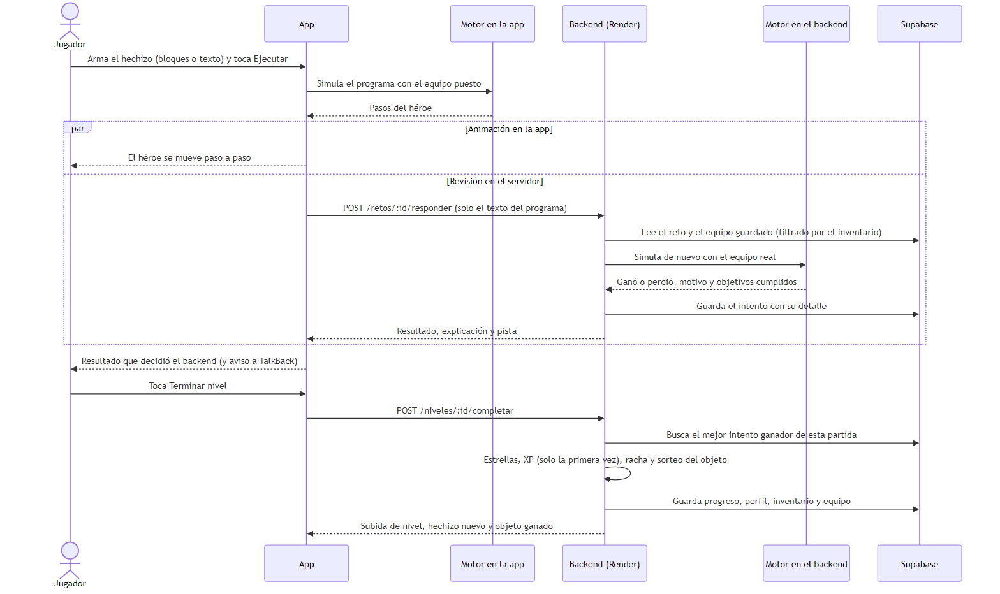
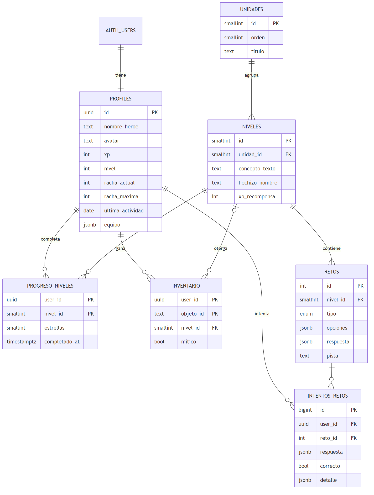

# 2. Arquitectura

**Proyecto:** DevLevel, aplicación móvil para aprender lógica de programación
**Asignatura:** Desarrollo de Aplicaciones Móviles, Universidad de La Sabana
**Documento:** Documento Técnico Final, Fase 3, Sección 2
**Equipo:** Ethian White y Tatiana Mayorga
**Fecha de entrega:** 12 de noviembre de 2026

Los diagramas están en [`diagramas/`](diagramas/), como imagen (`.png`) y como código Mermaid (`.mmd`) para poder editarlos.

---

## 2.1 Vista general

DevLevel tiene tres capas: la app móvil, una API propia y Supabase.



*Figura 2.1. Arquitectura general.*

| Capa | Tecnología | Dónde corre | Responsabilidad |
|---|---|---|---|
| App móvil | Expo SDK 58, React Native 0.88, TypeScript, expo-router | Celular Android (APK generado con EAS Build) | Pantallas, navegación, editor de bloques y de texto, animación de la mazmorra, accesibilidad |
| API | Node.js 22, Express 5, TypeScript | Render (servicio web, despliegue automático desde `main`) | Autenticación, reglas del juego, validación, ejecución autoritativa de los programas, progreso y objetos |
| Datos | Supabase: Auth y PostgreSQL | Nube de Supabase | Usuarios y contraseñas, contenido del módulo, progreso, intentos e inventario |

La comunicación entre la app y la API es HTTPS con JSON. Las rutas protegidas reciben el token de sesión en el encabezado `Authorization: Bearer <token>`.

## 2.2 Decisiones de arquitectura

| Decisión | Alternativa descartada | Por qué |
|---|---|---|
| **La app solo habla con una API propia**, nunca con Supabase | Conectar la app directamente a Supabase con la llave pública y políticas RLS | La llave secreta y las reglas del juego quedan en el servidor. Todas las tablas tienen RLS activado **sin políticas**, así que aunque alguien extraiga la llave pública del APK no puede leer ni escribir nada |
| **El backend es la autoridad del juego**: vuelve a ejecutar cada programa | Confiar en el resultado que calcula la app | Las estrellas, la XP y los objetos no se pueden falsificar enviando "gané" desde un cliente modificado. La app solo envía el texto del programa |
| **El motor de mazmorras es TypeScript puro y está compartido** | Escribir el motor dos veces o ejecutar el programa solo en el servidor | La app anima al instante sin esperar la red, y el servidor llega exactamente al mismo resultado. Una prueba automática verifica que las dos copias sean idénticas |
| **Pseudocódigo propio con un lector escrito a mano** | Ejecutar JavaScript del usuario con `eval` | Es seguro (no se ejecuta código arbitrario), está en español, da errores en lenguaje simple con número de línea y permite limitar los pasos para que un ciclo infinito no cuelgue nada |
| **Expo y EAS Build** | Proyectos nativos de Android Studio | Un solo código en TypeScript; el APK se compila en la nube sin configurar el SDK de Android en cada computador |
| **React Context** para el estado global | Redux u otra librería de estado | El estado global es pequeño (sesión, preferencias y onboarding); el estado de cada pantalla vive en la propia pantalla |
| **expo-secure-store** para la sesión | AsyncStorage | El token queda cifrado en el Keystore de Android. AsyncStorage se usa solo para datos no sensibles (preferencias y si ya se vio el onboarding) |
| **Pixel art dibujado en código** (mapas de letras convertidos a SVG) | Archivos de imagen | Sin archivos que cargar, nitidez a cualquier tamaño y la misma figura sirve con otra paleta (por ejemplo, la silueta gris de una casilla vacía) |
| **Render en plan gratis** | Servidor de pago | Suficiente para el proyecto. La contrapartida es que el servicio se duerme tras 15 minutos sin uso; la app espera hasta 60 segundos y muestra un mensaje claro si el servidor no responde |

## 2.3 App móvil

### 2.3.1 Estructura

```
movil/src/
├── app/              Pantallas (cada archivo es una ruta de expo-router)
│   ├── _layout.tsx   Proveedores de estado y rutas protegidas según la sesión
│   ├── (tabs)/       Mapa, Hechizos, Héroe y Ajustes
│   ├── nivel/[id]    Concepto → mazmorra → subida de nivel
│   └── login, onboarding, personaje, recuperar
├── components/       Mazmorra, editores, mapa del reino, pixel art, interfaz retro
├── juego/            Copia del motor de mazmorras y la lógica de los bloques
├── context/          Sesión, preferencias y onboarding
├── api/              Cliente HTTP y tipos de la API
├── hooks/            Por ejemplo, useReducirMovimiento
└── theme/            Colores, tipografías, tamaños y área táctil mínima (48 dp)
```

### 2.3.2 Navegación

La navegación usa expo-router con `Stack.Protected`: cada grupo de pantallas solo existe cuando su condición es verdadera. Así, por ejemplo, después de cerrar sesión no se puede volver con el botón Atrás a una pantalla que requiere sesión.



*Figura 2.2. Navegación entre pantallas.*

| Grupo | Condición | Pantallas |
|---|---|---|
| Primera vez | Sin sesión y sin haber visto el onboarding | Onboarding |
| Sin sesión | Sin sesión y con el onboarding visto | Login y crear cuenta, Recuperar contraseña |
| Con sesión | Sesión válida | Pestañas (Mapa, Hechizos, Héroe, Ajustes), Selección de personaje, Nivel |

Las pestañas usan los componentes de `expo-router/ui` para dibujar una barra propia con el estilo retro del juego. Cada pestaña tiene ícono y texto, y el lector de pantalla la anuncia como pestaña con su estado de seleccionada.

### 2.3.3 Estado

| Contexto | Qué guarda | Dónde persiste |
|---|---|---|
| `AuthContext` | Sesión, usuario y perfil (XP, nivel, racha, avatar, equipo). Ofrece `conSesion(...)`, que llama a la API con el token y, si responde 401, renueva la sesión una sola vez (aunque haya varias peticiones a la vez) y reintenta | Token y `refreshToken` en `expo-secure-store` |
| `PreferenciasContext` | Reducir movimiento, sonido y vibración | AsyncStorage |
| `OnboardingContext` | Si ya se vio la introducción | AsyncStorage |

El resto del estado es local a cada pantalla. Por ejemplo, el editor de bloques guarda una lista de bloques y la convierte en texto con `bloquesATexto`, y la pantalla de la mazmorra guarda el paso actual de la animación, la vida, la energía y el resultado.

### 2.3.4 Comunicación con la API

`src/api/cliente.ts` es el único lugar que conoce la URL del backend (`EXPO_PUBLIC_API_URL`). Convierte cualquier falla en un `ErrorApi` con un tipo y un mensaje listo para mostrar:

| Tipo | Cuándo | Qué ve el usuario |
|---|---|---|
| `sin-conexion` | No hay internet o el servidor no responde | "No hay conexión con el servidor. Revisa tu internet." |
| `tiempo` | Pasaron 60 segundos sin respuesta | "El servidor está tardando mucho en responder. Intenta de nuevo." |
| `validacion` (400) | Datos del formulario con errores | El mensaje de cada campo, debajo del campo |
| `sesion` (401) | Token vencido o inválido | Se renueva la sesión; si no se puede, se vuelve al login |
| `conflicto` (409) | Por ejemplo, correo ya registrado | Mensaje en el campo correspondiente |
| `servidor` (5xx) | Error inesperado | Mensaje genérico; el usuario puede volver a intentar la acción |

Un error de red nunca cierra la sesión del usuario: solo se cierra si el backend responde que la sesión ya no es válida.

## 2.4 Backend

### 2.4.1 Estructura

```
backend/src/
├── index.ts, app.ts        Arranque del servidor y registro de rutas
├── config/env.ts           Lee y valida las variables de entorno
├── middleware/
│   └── requiere-sesion.ts  Valida el token con Supabase Auth y deja el usuario en la petición
├── routes/                 Un archivo por recurso
└── lib/
    ├── mazmorra/           Motor: tipos, lector, simulador, objetos y las 15 mazmorras
    ├── progreso.ts         XP por nivel, estrellas, racha (con la fecha de Colombia)
    ├── equipo.ts           Equipo del jugador filtrado contra su inventario real
    ├── desbloqueo.ts       Si un nivel está disponible para el usuario
    ├── perfil.ts           Lectura del perfil y conversión a camelCase
    └── azar.ts             Fuente de azar del sorteo (reemplazable en las pruebas)
```

### 2.4.2 Endpoints

| Método y ruta | Sesión | Qué hace |
|---|---|---|
| `GET /health` | No | Estado del servidor y de la base de datos |
| `POST /auth/register`, `/auth/login`, `/auth/refresh` | No | Crear cuenta, iniciar sesión y renovar el token |
| `POST /auth/recuperar`, `/auth/restablecer` | No | Código por correo y cambio de contraseña. No revela si el correo existe |
| `GET /me`, `PATCH /me` | Sí | Perfil; cambiar nombre, clase y equipo (solo objetos del inventario) |
| `GET /mapa` | Sí | Unidades y niveles con su estado (completado, actual o bloqueado) y estrellas |
| `GET /niveles/:id` | Sí | Concepto y mazmorra del nivel (sin la solución) |
| `POST /retos/:id/responder` | Sí | Ejecuta el programa en el servidor y guarda el intento |
| `GET /retos/:id/pista-avanzada` | Sí | Pista avanzada si se tiene equipado el Pergamino del sabio o el Ojo de Odín |
| `POST /niveles/:id/completar` | Sí | Estrellas, XP, racha, subida de nivel, hechizo y sorteo del objeto |
| `GET /inventario` | Sí | Objetos ganados y equipo puesto |
| `GET /hechizos` | Sí | Libro de hechizos: conceptos desbloqueados y los que faltan |

Formato común: los errores son `{ "error": "mensaje" }`, y los de validación agregan `campos` con un mensaje por campo. La documentación con ejemplos de petición y respuesta está en [`backend/README.md`](../backend/README.md).

## 2.5 Motor de mazmorras

El motor está en `backend/src/lib/mazmorra/` y tiene una copia idéntica en `movil/src/juego/`. No depende de React, de Express ni de la base de datos, por eso funciona igual en los dos lados.

| Archivo | Qué hace |
|---|---|
| `tipos.ts` | Tipos compartidos: mazmorra, instrucción, paso, resultado y equipo |
| `lector.ts` | Convierte el texto del programa en un árbol de instrucciones. Normaliza mayúsculas y tildes faltantes, y si encuentra un error devuelve la línea y un mensaje simple con sugerencia ("¿Quisiste decir 'adelante()'?") |
| `simulador.ts` | Ejecuta el árbol sobre la cuadrícula y devuelve la lista de pasos (para la animación) y el resultado: si ganó, el motivo, vida, energía, monedas, choques, enemigos derrotados y objetivos cumplidos |
| `objetos.ts` | Las 25 reliquias, sus efectos sobre las estadísticas y el sorteo del mítico |
| `contenido.ts` (solo backend) | Las 15 mazmorras con su solución y la solución que cumple todos los objetivos extra. Las pruebas automáticas ejecutan las 30 soluciones para garantizar que cada mazmorra se puede ganar |

Reglas que garantizan que el juego sea justo y estable:

- **Determinista:** el mismo programa con el mismo equipo produce siempre el mismo resultado. El único azar del juego (el sorteo del mítico) ocurre en el backend, fuera del simulador.
- **Límite de 500 pasos de evaluación:** un `MIENTRAS` que nunca termina pierde con el motivo "El hechizo se repitió demasiadas veces", sin colgar la app ni el servidor.
- **Energía:** cada acción gasta 1 de energía; las condiciones no gastan. Así se premian los programas cortos.

### 2.5.1 Flujo de una mazmorra



*Figura 2.3. Qué pasa cuando el jugador toca Ejecutar y luego Terminar nivel.*

La app simula el programa para animar al héroe de inmediato y, al mismo tiempo, lo envía al backend. El resultado que se muestra al final es siempre el que decidió el backend.

## 2.6 Modelo de datos



*Figura 2.4. Modelo entidad-relación (Supabase PostgreSQL).*

| Tabla | Contenido |
|---|---|
| `profiles` | Un perfil por usuario de Supabase Auth: nombre de héroe, clase, XP, nivel, racha y equipo puesto (`equipo` en JSON con arma, armadura y amuleto) |
| `unidades`, `niveles` | Contenido del módulo: 5 unidades y 15 niveles con su concepto, hechizo y XP |
| `retos` | Un reto de tipo `mazmorra` por nivel. `opciones` guarda la mazmorra (mapa, energía, instrucciones permitidas, objetivos extra y objeto) |
| `progreso_niveles` | Mejores estrellas de cada usuario en cada nivel |
| `intentos_retos` | Cada ejecución enviada: el programa, si ganó y el `detalle` (vida, monedas, objetivos cumplidos y equipo usado) |
| `inventario` | Objetos ganados por usuario, de qué nivel salieron y si son míticos |

Los scripts están en `backend/supabase/`: `schema.sql` (tablas), `seed.sql` (unidades y niveles), `migracion-mazmorras.sql` (tipo `mazmorra`, inventario y equipo) y `seed-mazmorras.sql` (las 15 mazmorras, generado desde `contenido.ts` con `npm run seed:mazmorras`).

## 2.7 Seguridad

- **Llave secreta solo en el servidor:** `SUPABASE_SECRET_KEY` vive en las variables de entorno de Render. La app no tiene ninguna llave de Supabase.
- **RLS sin políticas:** ningún cliente puede acceder a las tablas directamente; solo el backend con la llave secreta.
- **Sesión cifrada en el celular:** el token se guarda en `expo-secure-store` y se renueva con el `refreshToken`.
- **Validación en el servidor:** todos los datos que llegan a la API se validan (correo, contraseña, nombre, clase, equipo, tamaño del programa de máximo 5000 caracteres), aunque la app ya los valide antes.
- **La solución nunca sale del servidor:** `GET /niveles/:id` envía la mazmorra sin la solución, y las pistas avanzadas solo se entregan con el objeto equipado.
- **Recuperación de contraseña sin filtrar información:** la respuesta es la misma exista o no la cuenta, y el código es de un solo uso.
- **Sin secretos en el repositorio:** los archivos `.env` están en `.gitignore`, y cada carpeta tiene un `.env.example`.

## 2.8 Despliegue y calidad

| Pieza | Cómo se despliega |
|---|---|
| Backend | Render construye y publica automáticamente cada cambio en `main` (`npm install --include=dev && npm run build`, luego `npm start`). Health check en `/health` |
| Base de datos | Scripts SQL ejecutados en el SQL Editor de Supabase. El correo de recuperación usa un SMTP propio con una plantilla que muestra el código |
| App | `eas build -p android --profile preview` genera el APK; la URL del backend viene del perfil en `eas.json` |

Calidad:

- **Backend:** 159 pruebas automáticas (`npm test`) que levantan la API real con una base de datos falsa en memoria, y revisión de tipos con TypeScript.
- **App:** revisión de tipos con TypeScript y ESLint con `eslint-plugin-react-native-a11y` para las reglas de accesibilidad.
- **Sistema completo:** 33 casos de prueba funcionales ejecutados contra el backend desplegado ([`casos-de-prueba.md`](casos-de-prueba.md)).
